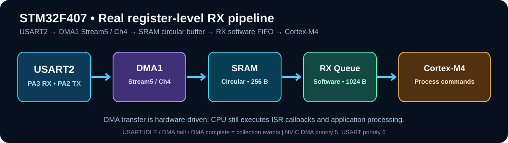

# STM32F407 | Hardcore Bare-Metal Driver Lab

**Real STM32F407 Discovery firmware, not an animated dashboard.** No HAL, no FreeRTOS, no external libraries. GPIO, USART2, DMA1, SPI1, NVIC and DWT are configured from **memory-mapped registers**. Designed for STM32F407VG at its default **16 MHz HSI clock**.



> **Verification status:** Cross-compiled and linked for ARM Cortex-M4 using Clang/LLD in a build environment. No physical STM32F407 board was available for hardware validation. Actual wire-level timing, UART errors and sensor detection still need testing. All screenshots/GIFs inside `assets` are *illustrations*, not lab measurements.

## Contents

| Code | Purpose |
|---|---|
| `src/startup.c` | Cortex-M vector table, reset, .data and .bss initialization |
| `src/board.c` | GPIO: PD12 green LED, PD13 timing-probe; 1ms SysTick |
| `src/uart.c` | USART2 RX circular DMA1 Stream5 Channel4, idle interrupts, IRQ-based TX ring, polling comparison |
| `src/spi.c` | SPI1 Mode 0, 2 MHz loopback; onboard accelerometer ID |
| `src/timing.c` | DWT->CYCCNT, cycle-to-microsecond conversion |
| `src/memory.c` | Freestanding memory helpers for standalone linking |
| `src/main.c` | Interactive UART command-line firmware and counters |
| `include/hw.h` | STM32F407 addresses, register maps, NVIC helpers |
| `linker/stm32f407vg.ld` | 1 MiB FLASH and 128 KiB contiguous SRAM |
| `Makefile` | Standalone ARM GNU toolchain build |
| `.github/workflows/build.yml` | GitHub Actions firmware build |

## 1. Hardware

- STM32F4 Discovery **STM32F407VGT6** board (not an F401/F411 board)
- ST-LINK USB cable to power, flash and debug
- USB-to-TTL adapter with **3.3V logic** (USART2: RX/TX at 3.3V)
- Female jumper wires
- For SPI loopback: 1 wire between **PA7** and **PA6**
- Optional oscilloscope or logic analyzer for PD13 pulses

**Wiring** — Do not connect the adapter's 5V output to the STM32's GPIO pins.

| Discovery board pin | USB-UART / other connection | Purpose |
|---|---|---|
| PA2 | USB-UART RX | USART2 transmit |
| PA3 | USB-UART TX | USART2 receive |
| GND | USB-UART GND | Shared reference |
| PD12 | Onboard green LD4 | LED command |
| PD13 | Onboard orange LD3 / optional logic analyzer probe | Timing pulse |
| PA5 | Optional SPI clock analyzer probe | SPI1 SCK |
| PA7 | PA6 (loopback-only) | SPI1 MOSI |
| PA6 | PA7 (loopback-only) | SPI1 MISO |
| PE3 | Onboard MEMS chip select | Hardware sensor ID |

**Important:** Remove the **PA7-to-PA6 jumper** before executing `accel`. The onboard MEMS accelerometer shares SPI1; its chip-select is **PE3**. Depending on board revision, the accelerometer may be LIS302DL (ID `0x3B`) or LIS3DSH (ID `0x3F`).

## 2. Install build tools

### Windows — straightforward workflow

1. Install **STM32CubeProgrammer** from ST (for flashing over onboard ST-LINK).
2. Install **Git for Windows**.
3. Install **Arm GNU Toolchain (arm-none-eabi-gcc)** and **GNU Make**, or build inside Ubuntu/WSL (recommended when Make is missing on Windows).
4. Check: `arm-none-eabi-gcc --version`, `make --version`, `git --version`.
5. If you build in WSL, flash from **Windows STM32CubeProgrammer** by browsing to the built `.bin` file. This avoids forwarding the ST-LINK USB device to WSL.

### Ubuntu Linux (also works in WSL for building)

```bash
sudo apt update
sudo apt install -y git make gcc-arm-none-eabi binutils-arm-none-eabi openocd
```

## 3. Build

```bash
git clone https://github.com/YOUR_USERNAME/stm32f407-hardcore-baremetal.git
cd stm32f407-hardcore-baremetal
make
```

`YOUR_USERNAME` above is a **placeholder**. Until you publish your repository, download and extract the provided ZIP and run `make` in that directory instead.

Expected new files:

```text
build/stm32f407_baremetal.elf   # symbols, debugging
build/stm32f407_baremetal.bin   # firmware image
build/stm32f407_baremetal.map   # symbol/map information
```

The toolchain should report `.text`, `.data`, `.bss` sizes at the end. You do **not** need STM32CubeMX or HAL headers because the register definitions are included.

## 4. Flash the firmware

**Option A: STM32CubeProgrammer GUI (Windows)**

1. Plug STM32F4 Discovery's **ST-LINK USB** into the PC (not the USB OTG connector).
2. Launch STM32CubeProgrammer; choose **ST-LINK** > **Connect**.
3. Choose the firmware file `build/stm32f407_baremetal.bin`.
4. If writing a raw `.bin`, enter the **start address `0x08000000`**.
5. Click **Start Programming**, then **Reset**.

**Option B: OpenOCD (Linux, native ST-LINK USB access)**

```bash
make flash
```

The Makefile invokes the OpenOCD configuration for an ST-LINK interface and the STM32F4x target. If your OpenOCD package uses different interface configuration files, adjust the `flash` target.

## 5. Open a serial terminal

Connect a **3.3V USB-UART adapter** as in the wiring table. The onboard ST-LINK USB does not necessarily expose USART2 as a prewired virtual COM port on older Discovery revisions.

- Serial: **115200**, **8 data bits**, **no parity**, **1 stop bit**
- Line ending: `CR`, `LF`, or `CRLF`
- Terminal examples: PuTTY, Tera Term, minicom, or `python tools/serial_capture.py COM6`

Commands (type a line and press Enter):

```text
help
led on
led off
led t
mode dma
stats
resetstats
mode poll
stats
mode dma
spi
accel
clock
about
```

**Do not run `spi` without connecting PA7 to PA6**; it will correctly report FAIL. **Remove the jumper before `accel`**, so that the onboard MEMS device can respond.

## 6. Compare UART polling versus DMA

### A. Polling mode

```text
mode poll
resetstats
stats
```

`src/main.c` repeatedly calls `uart_try_read()`. In polling mode that checks USART2->SR for RXNE and directly reads USART2->DR. The `poll_iterations` statistic reflects *reads attempted* by the foreground loop, **not CPU utilization**.

### B. DMA circular mode

```text
mode dma
resetstats
stats
```

USART2 generates DMA receive requests; DMA1 Stream5 Channel4 copies received bytes directly to a **256-byte circular SRAM buffer**. DMA half-transfer, full-transfer and USART idle events harvest new bytes into a **1024-byte software queue**. The main loop processes the queue while hardware keeps receiving.

**Important limitations:** The 256-byte DMA buffer can still overrun when interrupt servicing is delayed for too long. Software-queue overflow is counted as `rx_dropped`, but *DMA silent overwrite before servicing cannot always be detected* with a single cursor. USART TX uses its own interrupt-driven 1024-byte queue. UART interrupt counts include TX activity, so compare controlled workloads before claiming interrupt-rate improvements.

### DMA channel details

```text
USART2 RX -> DMA1 Stream5 / Channel4 -> 256-byte circular buffer
                                     -> (HT, TC, or USART IDLE event)
                                     -> 1024-byte software FIFO
                                     -> application command parser
USART2 TX <- TXE interrupt <- 1024-byte software FIFO <- print functions
```

## 7. SPI1 loopback

1. Power off the board before changing wiring.
2. Connect **PA7 to PA6** on the STM32F4 Discovery header (MOSI -> MISO).
3. Reconnect and run `spi` in the serial terminal.
4. Expected sent and received test pattern: `0x9F 0xEF 0x40 0x19`.
5. The firmware asserts **PD13 HIGH** during the SPI loopback and returns it LOW after the transfer. Attach an oscilloscope/logic analyzer to PD13 plus ground to measure elapsed wall-clock timing externally.

The code uses **SPI Mode 0**, 8-bit transfers, and a 2 MHz SPI clock at HSI 16 MHz. The test duration also includes code and GPIO overhead. To read the onboard accelerometer ID instead, remove the jumper and run `accel`.

## 8. Measure CPU cycles accurately

The Cortex-M4 DWT register `CYCCNT` increments each CPU cycle (after trace is enabled). The software reads it at the beginning/end of the measured function:

```c
uint32_t t0 = timing_cycles();
/* operation under test */
uint32_t cycles = timing_cycles() - t0;
```

**Formula:** `elapsed microseconds = cycles / CPU_frequency_MHz`.

For the **16 MHz** firmware in this repository, `6432 cycles = 402.00 us`. If the clock is *actually* **168 MHz**, `6432 cycles = 38.29 us` (not `4.02 us`). The reference graphic in `assets/architecture-concept.png` contains a mismatched time/cycle annotation and must **not** be cited as a test report.

`stats` prints **maximum observed time inside the USART and DMA interrupt handlers**. These are *handler durations*, **not full interrupt-entry latency**, and are influenced by the workload and instrumentation. To measure worst-case interrupt response latency, use a GPIO trigger, input interrupt and a logic analyzer with a controlled stimulus and stress conditions.

## 9. Git/GitHub publish from scratch

From the extracted project folder:

```bash
git init
git branch -M main
git add .
git commit -m "Initial STM32F407 bare-metal UART DMA SPI NVIC DWT lab"
```

Open [github.com/new](https://github.com/new), sign in, create a **public** repository named `stm32f407-hardcore-baremetal`, and do **not** initialize it with a GitHub README (this project already has one). Then replace `YOUR_USERNAME` with your GitHub username:

```bash
git remote add origin https://github.com/YOUR_USERNAME/stm32f407-hardcore-baremetal.git
git push -u origin main
```

GitHub will require an appropriate authentication method (browser sign-in, Git Credential Manager, or a personal access token), not your account password typed at the terminal.

**Future changes:**

```bash
git add .
git commit -m "Improve DMA diagnostics and SPI timing"
git push
```

A GitHub Actions workflow is included to cross-compile the firmware whenever code is pushed. A passing CI build **does not mean** physical-hardware testing passed.

## Reference documents

- [STM32F407 RM0090 Reference Manual](https://www.st.com/resource/en/reference_manual/rm0090-stm32f407-advanced-armbased-32bit-mcus-stmicroelectronics.pdf)
- [STM32F407 ST product documentation](https://www.st.com/en/microcontrollers-microprocessors/stm32f407-417/documentation.html)
- [STM32F4 Discovery board documentation](https://www.st.com/en/evaluation-tools/stm32f4discovery.html)

## Licensing

MIT license; see `LICENSE`. This demonstration is intended for learning, inspection and testing, not safety-critical production use.
